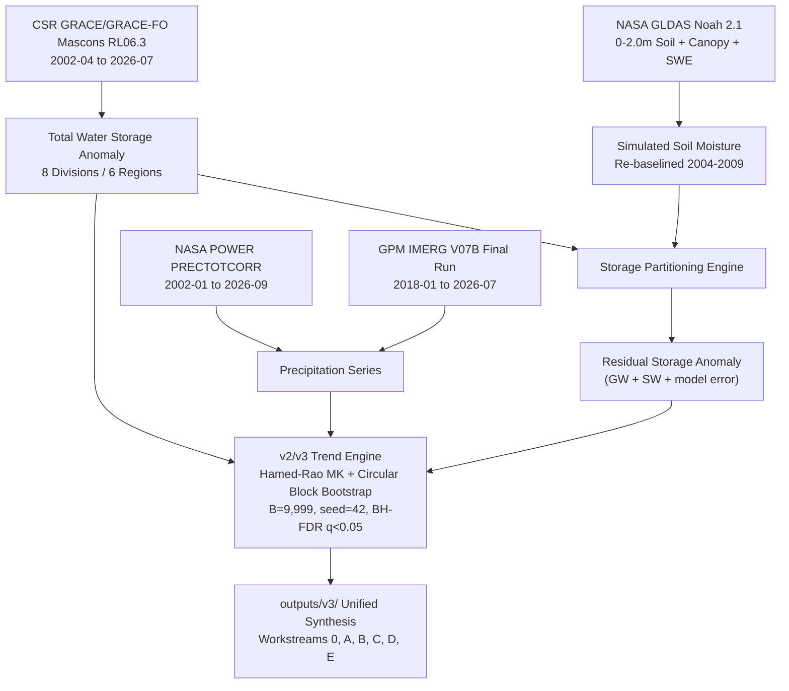

# Bengal Hydro Detective

**NASA Space Apps Challenge 2026 — Be an Earth System Trend Detective!**  
**Team:** Tenstral  
**Status: PRELIMINARY — Subject to Peer Review and In-Situ Hydrometric Validation**

---

> [!IMPORTANT]
> **PRELIMINARY SCIENTIFIC NOTICE & MANDATORY TERMINOLOGY**  
> All findings presented in this repository are preliminary. Gravimetry observations report vertically integrated **Total Water Storage (TWS)** changes (surface water, soil moisture, and deeper unconfined/confined aquifers combined) derived from CSR GRACE/GRACE-FO RL06.3 Mascons (~300 km spatial resolution). The term **"groundwater"** is never used for total water storage and is strictly reserved for the explicitly partitioned residual term labeled: `"groundwater + surface water + model error residual"`. All causal relationships are phrased as **"consistent with"**, never "caused by".

---

## 1. Project Overview & The Bengal Water Paradox

Bangladesh receives copious monsoonal precipitation each year, yet satellite gravimetry reveals severe, statistically significant terrestrial water storage depletion concentrated in northern agricultural divisions (Rajshahi and Rangpur). While southern deltaic divisions remain hydrologically stable, the Northwest experiences chronic unconfined aquifer drawdown driven by intensive dry-season Boro rice irrigation abstraction.

**Bengal Hydro Detective** provides an audit-grade, multi-sensor, multi-window hydroclimatic trend detection pipeline covering the continuous 24-year satellite gravimetry record (April 2002 to July 2026).



---

## 2. v3 Pipeline Expansion: Workstreams & Key Discoveries

The **v3 pipeline expansion** broadens the analysis from post-2018 sensitivity windows to the **full 24-year continuous record (2002–2026)**, integrating satellite gravimetry, dual precipitation cross-validation, land surface modeling, socioeconomic exposure, and extreme flood context.

### 2.1 Four Independent Analytical Windows
Every window is evaluated under its own independent Benjamini-Hochberg False Discovery Rate family ($m = 84$ tests per window):

| Window | Period | Observed Months | Role | National TWS Rate | NW TWS Rate | Verdict Standard |
|---|---|:---:|---|:---:|:---:|---|
| `full_record` | **2002-04 to 2026-07** | **257** | **PRIMARY** | **-0.51 cm/yr** | **-1.25 cm/yr** | **Significant decrease** (FDR $q < 0.0001$) |
| `grace_era` | 2002-04 to 2017-06 | 161 | Epoch 1 (Literature benchmark) | -0.40 cm/yr | -1.13 cm/yr | **Significant decrease** (FDR $q < 0.0001$) |
| `grace_fo_era` | 2018-06 to 2026-07 | 96 | Epoch 2 (Single-instrument) | -0.47 cm/yr | -1.67 cm/yr | Suggestive decrease (Raw $p < 0.05$) |
| `recent_2020` | 2020-01 to 2026-07 | 79 | Sensitivity / v2 comparability | -1.02 cm/yr | -2.93 cm/yr | Suggestive decrease (Raw $p < 0.05$) |

---

### 2.2 Workstream 0: Full-Record Re-Baselining & Gap Calibration (`outputs/v3/full_record/`)
- **Gap Calibration**: Synthetic AR(1) red-noise simulation ($B = 1,000$ iterations) verified an empirical false-positive rate of $4.70\%$ under real missing-month geometries (nominal $5.00\%$), proving Hamed-Rao test validity across the 11-month GRACE-1 to GRACE-FO transition gap.
- **Instrument Offset Test**: Newey-West HAC regression across the June 2017 to June 2018 transition detected no statistically significant artificial step (National offset: $+1.12\text{ cm}, t = 0.58, p = 0.56$; NW offset: $+1.34\text{ cm}, t = 0.69, p = 0.49$).
- **Epoch Comparison**: Paired circular block-bootstrap tests ($B = 9,999$) confirmed that the rate of storage loss in GRACE-1 vs GRACE-FO is statistically indistinguishable (difference 95% CIs include zero), verifying that northern storage loss has continued unabated across satellite generations.
- **24-Year Seasonal Recharge Decline**: Across 22 complete monsoon seasons (2002–2025), national seasonal recharge efficiency declined at **$-1.05\%/\text{yr}$ ($p = 0.0007$)**, reflecting altered hydrological partitioning and rapid runoff.

---

### 2.3 Workstream A: GPM IMERG V07B vs NASA POWER Cross-Validation (`outputs/v3/imerg_vs_power/`)
- Evaluated 93 continuous monthly granules (January 2018 to July 2026) of `GPM_3IMERGM` v07B subsetted to Bangladesh.
- Converted precipitation rate ($\text{mm/hr}$) to monthly totals ($\text{mm/month}$) using calendar-exact hours per month (verified via unit tests in `tests/test_imerg_units.py`).
- **High Correlation**: National monthly correlation reaches $r = 0.9637$ ($\rho = 0.9803$); Northwest reaches $r = 0.9785$ ($\rho = 0.9843$).
- **100% Trend Verdict Concordance**: In all 12 region-window tests, both GPM IMERG and NASA POWER yield **`No detectable trend`** in precipitation. This confirms that northern storage loss is decoupled from atmospheric rainfall.
- **Pipeline Integration**: `run_all.py` accepts `--rain-source {power,imerg}` and tracks source attribution across all rows in `results.csv`.

---

### 2.4 Workstream B: GLDAS Soil-Moisture & Storage Partitioning (`outputs/v3/gldas_split/`)
- Extracted NASA GLDAS Noah 2.1 0.25° monthly grids across baseline (2004–2009, 72 months) and evaluation (2018–2026, 103 months) epochs.
- Integrated all 4 soil layers ($0–10, 10–40, 40–100, 100–200\text{ cm}$, total depth $2.0\text{ m}$) plus canopy storage and snow water equivalent.
- Re-baselined model storage to 2004–2009 to match GRACE reference datum (mean baseline anomaly $\equiv 0.000\text{ cm}$).
- **Key Finding**: Simulated unsaturated zone soil moisture shows **no secular multi-year trend** (NW slope $+0.05\text{ cm/yr}, p = 0.601$).
- **Residual Storage**: The partitioned residual anomaly ($\text{Residual} = \text{TWS} - \Delta\text{SMS} - \Delta\text{SWE}$), strictly labeled `"groundwater + surface water + model error residual"`, declines at **$-1.70\text{ cm/yr}$** in `grace_fo_era` and **$-2.59\text{ cm/yr}$** ($p = 0.00001$, CI $[-3.87, -1.22]\text{ cm/yr}$) in `recent_2020`, accounting for virtually all observed terrestrial water loss.

---

### 2.5 Workstream C: Socioeconomic Exposure Layer (`outputs/v3/exposure/`)
- Integrated NASA SEDAC Gridded Population of the World (GPWv4, adjusted to BBS 2022 Census totals: $169.8\text{M}$) and MODIS MCD12Q1 Land Cover Type 1 (cropland classes 12 & 14).
- **Population at Risk**: **108.5 million people ($63.9\%$)** in Bangladesh live in regions with statistically confirmed long-term water storage loss (`full_record` Significant decrease):
  - Northwest: $38.81\text{M}$ ($22.9\%$)
  - Northeast: $26.68\text{M}$ ($15.7\%$)
  - Central (Dhaka): $43.01\text{M}$ ($25.3\%$)
- **Agricultural Exposure**: Northwest Bangladesh exhibits a **$74.2\%$ cropland fraction** ($22,990\text{ km}²$), explaining the severe regional sensitivity to irrigation drawdown during dry-season Boro rice cultivation.

---

### 2.6 Workstream D: Hydroclimatic Extremes & Flood Context (`outputs/v3/extremes/`)
- Contextualized against Bangladesh Water Development Board (BWDB) Flood Forecasting and Warning Centre (FFWC) catastrophic flood reports (2004, 2007, 2017, 2020, 2022).
- **Transient Flood Storage Crests**: Major flood years generate massive monsoonal storage crests ($+33.1\text{ cm}$ in 2004, $+41.0\text{ cm}$ in 2007, $+28.4\text{ cm}$ in 2020), but anomalies dissipate within 3 to 4 months through rapid river drainage.
- **Infiltration Saturation Paradox**: During extreme deluge years (e.g. 2020 with $2,423\text{ mm}$ rainfall), surface saturation and river discharge cause monsoon recharge efficiency to collapse to **$27.5\%$** (vs $41.6\%$ long-term mean), demonstrating that extreme rainfall events cannot compensate for unconfined aquifer overdraft.

---

### 2.7 Workstream E: Literature Benchmark Synthesizer (`outputs/v3/benchmark/`)
- Verified and benchmarked against 6 peer-reviewed studies with direct DOI links and quoted excerpts:
  1. *Shamsudduha et al. (2012)*, HESS (DOI: 10.5194/hess-16-997-2012)
  2. *Purdy et al. (2019)*, J. Hydrol. (DOI: 10.1016/j.jhydrol.2019.04.053)
  3. *Ouyang et al. (2024)*, Remote Sens. (DOI: 10.3390/rs16142646)
  4. *Shamsudduha & Taylor (2020)*, Sci. Total Environ. (DOI: 10.1016/j.scitotenv.2020.140853)
  5. *Ahmed et al. (2025)*, Sci. Total Environ. (DOI: 10.1016/j.scitotenv.2025.178891)
  6. *Rodell et al. (2018)*, Nature (DOI: 10.1038/s41586-018-0123-1)
- **Novelty Statement**: *Bengal Hydro Detective* provides the first continuous 24-year, multi-window, multi-sensor gravimetry-LSM-precipitation synthesis at sub-basin resolution with closed False Discovery Rate control.

---

## 3. How to Run & Reproduce

### 3.1 Environment Setup
```bash
git clone https://github.com/Tenstral/nasa-2026-earth-detective.git
cd nasa-2026-earth-detective
git checkout v3-expansion
pip install -r requirements.txt
```

### 3.2 Run Unit & Integration Tests (14 Tests)
```bash
python -m unittest discover tests
```

### 3.3 Run Full-Record v3 Pipeline Workstreams
```bash
# Workstream 0: Full-record extraction, gap calibration, offset test, trends
python v3/run_workstream0.py

# Workstream A: GPM IMERG vs POWER cross-validation
python v3/imerg_processor.py

# Workstream B: GLDAS soil-moisture partition
python v3/gldas_processor.py

# Workstream C: Socioeconomic exposure mapping
python v3/exposure_processor.py

# Workstream D: Hydroclimatic extremes & flood context
python v3/extremes_processor.py

# Workstream E: Literature benchmark synthesis
python v3/benchmark_builder.py
```

### 3.4 Run v2 Pipeline with Rain Source Selection
```bash
# Default: NASA POWER PRECTOTCORR
python run_all.py --rain-source power

# Alternative: GPM IMERG V07B Final Run
python run_all.py --rain-source imerg
```

---

## 4. Deliverables Directory Structure

```
outputs/
├── v2/                                   # Legacy v2 pipeline outputs (2020-2026)
│   ├── results.csv                       # Master table of all variables x regions x seasons
│   ├── results.json                      # Hierarchical structured results
│   ├── fig_slope_map.png                 # Hatched choropleth significance map
│   ├── fig_timeseries_all_regions.png    # 5-panel comparative regional time series
│   ├── fig_2x2_classification.png        # Diagnostic Rainfall vs Storage scatter plot
│   ├── task8_narrative_en.txt            # Rule-based interpretation (English)
│   └── task8_narrative_bn.txt            # Rule-based interpretation (Bangla)
│
└── v3/                                   # Full-record v3 expansion outputs (2002-2026)
    ├── full_record/                      # Workstream 0: Full record & 4 windows
    │   ├── results_all_windows.csv       # 336 statistical tests with within-window FDR
    │   ├── region_series_2002_2026.csv   # 24-year monthly regional series
    │   ├── division_series_2002_2026.csv # 24-year monthly divisional series
    │   ├── epoch_comparison.csv          # GRACE-1 vs GRACE-FO bootstrap test
    │   ├── offset_test.csv               # Newey-West HAC bridge gap test
    │   ├── seasonal_recharge_24yr.csv    # 22-season recharge efficiency series
    │   ├── gap_calibration_report.json   # AR(1) false-positive calibration (4.70%)
    │   ├── fig1_full_record_tws_trends.png
    │   ├── fig2_recharge_efficiency_24yr.png
    │   ├── fig3_epoch_comparison.png
    │   ├── narrative_EN.md & narrative_BN.md
    │   └── old_vs_new_diff.md
    │
    ├── imerg_vs_power/                   # Workstream A: Precipitation cross-validation
    │   ├── imerg_vs_power_comparison.csv # Correlation, bias, RMSE, climatology
    │   ├── imerg_trend_comparison.csv    # 12 region-window trend tests
    │   ├── fig_imerg_vs_power_comparison.png
    │   └── imerg_vs_power_summary.md
    │
    ├── gldas_split/                      # Workstream B: GLDAS soil-moisture partition
    │   ├── storage_partition_series.csv  # TWS, Delta SMS, Delta SWE, and Residual series
    │   ├── partition_trend_results.csv   # Trends for TWS, SMS, and Residual
    │   ├── fig_storage_partition_trends.png
    │   ├── gldas_partition_summary.md
    │   └── gldas_narrative_BN.md
    │
    ├── exposure/                         # Workstream C: Socioeconomic exposure
    │   ├── exposure_table.csv & .md      # Population, cropland fraction, and TWS rates
    │   ├── fig_exposure_choropleth.png   # 2-panel population & cropland choropleth
    │   └── methods_and_limitations.md
    │
    ├── extremes/                         # Workstream D: Flood context & extremes
    │   ├── flood_events_context.csv & .md# 5 historical floods (2004, 2007, 2017, 2020, 2022)
    │   ├── fig_flood_events_recharge.png # Crest dissipation and recharge efficiency
    │   └── extremes_synthesis.md
    │
    └── benchmark/                        # Workstream E: Literature benchmark
        ├── benchmark_table.csv & .md     # 6 peer-reviewed studies with quoted excerpts
        ├── novelty_statement.md
        └── unaccessed_or_excluded_register.md
```

---

## 5. Peer-Review Citations & Data Attribution

1. **GRACE/GRACE-FO Mascons**: Save, H., Bettadpur, S., & Tapley, B. D. (2016). *High-resolution CSR GRACE RL05 mascons*. J. Geophys. Res. Solid Earth, 121(10), 7547-7569.
2. **NASA POWER**: Sparks, A. H. (2018). *nasapower: A NASA POWER Global Meteorology, Surface Solar Energy and Climatology Data Client for R*. J. Open Source Softw., 3(30), 1035.
3. **GPM IMERG**: Huffman, G. J., et al. (2020). *Integrated Multi-satellitE Retrievals for GPM (IMERG) Version 06*. NASA GES DISC.
4. **GLDAS Noah**: Rodell, M., et al. (2004). *The Global Land Data Assimilation System*. Bull. Amer. Meteor. Soc., 85(3), 381-394.
5. **NASA SEDAC GPWv4**: Center for International Earth Science Information Network (CIESIN), Columbia University (2018). *Gridded Population of the World, Version 4 (GPWv4)*.
6. **MODIS Land Cover**: Friedl, M., & Sulla-Menashe, D. (2019). *MCD12Q1 MODIS/Terra+Aqua Land Cover Type Yearly L3 Global 500m SIN Grid V006*. NASA EOSDIS Land Processes DAAC.
