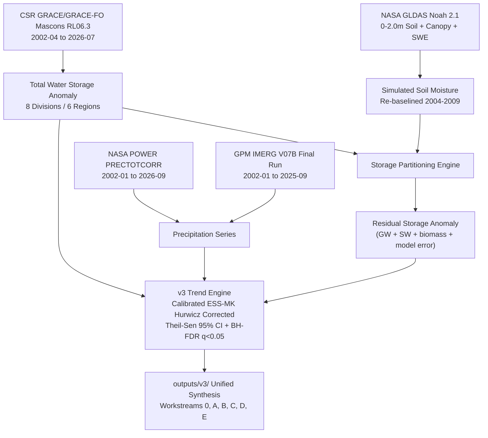

# Bengal Hydro Detective

**NASA Space Apps Challenge 2026 — Be an Earth System Trend Detective!**  
**Team:** Tenstral  
**Status: PRELIMINARY — Subject to Peer Review and In-Situ Hydrometric Validation**

---

> [!IMPORTANT]
> **PRELIMINARY SCIENTIFIC NOTICE & MANDATORY TERMINOLOGY**  
> All findings presented in this repository are preliminary. Gravimetry observations report vertically integrated **Total Water Storage (TWS)** changes (surface water, soil moisture, and deeper subsurface storage combined) derived from CSR GRACE/GRACE-FO RL06.3 Mascons (~300 km spatial resolution). The term **"groundwater"** is never used for total water storage and is strictly reserved for the explicitly partitioned residual term labeled: `"unpartitioned residual (groundwater + surface water + biomass + model error)"`. All attribution relationships are phrased as **"consistent with"**, avoiding causal attribution language.

---

## 1. Project Overview & Research Framework

Bangladesh receives copious monsoonal precipitation each year, yet satellite gravimetry reveals severe, statistically significant terrestrial water storage depletion observed in northern agricultural divisions (Rajshahi and Rangpur). While southern deltaic divisions show no detectable trend, the Northwest experiences chronic total water storage decline (-1.25 cm/yr) consistent with intensive dry-season Boro rice irrigation abstraction.

**Bengal Hydro Detective** provides an audit-grade, multi-sensor, multi-window hydroclimatic trend detection pipeline covering the continuous 24-year satellite gravimetry record (April 2002 to July 2026).

### 1.1 Interactive Web Application (Dr. James Acker's 5-Step Workflow)

The project includes a 100% client-side, zero-dependency interactive web application directly implementing Dr. James Acker's 5-step analytical workflow:
1. **Select Variable(s)**: Choose from GRACE/GRACE-FO Total Water Storage, GPM IMERG satellite precipitation, NASA POWER reanalysis, GLDAS Noah/VIC root-zone soil moisture, partitioned subsurface residual, daily precipitation extremes, and NASA AERONET atmospheric aerosols.
2. **Define Region**: Interactive vector map covering Bangladesh's 5 macro-regions, National aggregate, and 8 administrative divisions.
3. **Select Time Window & Season**: Configurable year range (2002–2026), 4 canonical baseline presets, and scientifically valid seasonal aggregation (one observation per year).
4. **Generate & Inspect Time Series**: Real-time Chart.js canvas rendering observations, fitted Theil-Sen trend line, 95% slope uncertainty bounds, and inter-satellite mission gap shading.
5. **Test for Statistical Significance**: Calibrated Effective-Sample-Size Mann-Kendall engine executing live in browser JavaScript with $p < 0.05$ challenge standard, within-window Benjamini-Hochberg FDR auditing, and Dr. Acker's window-length lesson.

- **`index.html`**: Interactive Trend Detective Workbench (with 6 guided case files).
- **`report.html`**: Comprehensive 24-year scientific research report.

**Quick Launch:**
```bash
# Launch via standard Python HTTP server
python3 -m http.server 8000
# Visit http://localhost:8000 in your browser, or double-click index.html
```



---

## 2. v3 Pipeline Expansion: Workstreams & Key Discoveries

The **v3 pipeline expansion** broadens the analysis from post-2018 sensitivity windows to the **full 24-year continuous record (2002–2026)**, integrating satellite gravimetry, dual precipitation cross-validation, land surface modeling, socioeconomic exposure, and extreme flood context.

### 2.1 Four Independent Analytical Windows
Every window is evaluated under its own independent Benjamini-Hochberg False Discovery Rate family ($m = 84$ tests per window):

| Window | Period | Observed Months | Role | National TWS Rate [95% CI] | NW TWS Rate [95% CI] | Calibrated Verdict (ESS-MK) |
|---|---|:---:|---|:---:|:---:|---|
| `full_record` | **2002-04 to 2026-07** | **257** | **PRIMARY** | **-0.51 [-0.66, -0.38]** | **-1.25 [-1.50, -1.02]** | **Significant decrease** (FDR $q < 0.0001$) |
| `grace_era` | 2002-04 to 2017-06 | 161 | Transition-free baseline | -0.68 [-0.92, -0.45] | -1.56 [-1.96, -1.17] | **Significant decrease** (FDR $q < 0.0001$) |
| `grace_fo_era` | 2018-06 to 2026-07 | 96 | Single-instrument era | -0.47 [-1.50, +0.53] | -1.67 [-3.32, +0.06] | No detectable trend (CI includes zero) |
| `recent_2020` | 2020-01 to 2026-07 | 79 | Sensitivity / legacy window | -1.02 [-2.53, +0.51] | -2.93 [-4.97, -0.78] | Method-dependent (raw $p = 0.0107$, FDR $q = 0.0772$), below the detection limit |

---

### 2.2 Workstream 0: Full-Record Re-Baselining & Gap Calibration (`outputs/v3/full_record/`)
- **Gap Calibration**: 2,000-run Monte Carlo simulation under real missing-month geometries verified that Effective-Sample-Size (ESS) corrected Mann-Kendall with Hurwicz bias correction achieves empirical false-positive rates of 5.0–5.8% (nominal 5.0%) and 94.2–95.0% CI coverage across empirical regional autocorrelations ($\phi \in [0.45, 0.83]$), establishing it as the primary calibrated significance test. Hamed-Rao (FPR 13–25%) failed calibration and is retained as secondary reference only.
- **Instrument Offset Test**: A step model across the June 2017 to June 2018 transition evaluated with Newey-West HAC standard errors detects significant offsets in NW (+9.15 cm, p = 0.028) and Central (+6.93 cm, p = 0.047); NE (+6.82 cm, p = 0.051), National (+5.81 cm, p = 0.071), SW (+2.38 cm, p = 0.468), and SE (+2.46 cm, p = 0.455) show no detectable offset. When transition months (±6 months around the gap) are excluded, no region is significant (NW +7.83 cm, p = 0.171; NE +4.00 cm, p = 0.402; Central +3.93 cm, p = 0.385; SW -0.89 cm, p = 0.830; SE -1.27 cm, p = 0.756; National +3.09 cm, p = 0.486). Because a mission step looks like part of a trend to the test, we report three NW estimates: single line, step-adjusted and transition-excluded (-1.25, -1.81 and -1.29 cm/yr).
- **Epoch Comparison**: Paired circular block-bootstrap tests ($B = 9,999$) show that the difference in storage loss rate between GRACE-1 and GRACE-FO is statistically indistinguishable (difference 95% CI includes zero: $+0.21$ [$-0.71, +1.13$] cm/yr), consistent with northern storage loss continuing across satellite generations without detectable secular acceleration or deceleration.
- **24-Year Seasonal Storage Response Ratio**: Across 22 complete monsoon seasons (2002–2025), GPM IMERG V07B precipitation is consistent with the national seasonal storage response ratio (storage rebound divided by monsoon rain, $\Delta\text{TWS} / P_{\text{monsoon}}$) averaging 32.6% (+0.136%/yr, raw p = 0.021, FDR q = 0.111; Suggestive increase), resolving the previous -1.05%/yr decline as a denominator artifact of NASA POWER's post-2015 surge. *Limitation:* reflects bulk total water storage change (unpartitioned storage), not isolated subsurface recharge.

---

### 2.3 Workstream A: GPM IMERG V07B vs NASA POWER Cross-Validation (`outputs/v3/imerg_vs_power/`)
- Evaluated 285 continuous monthly granules (January 2002 to September 2025) of `GPM_3IMERGM` v07B subsetted to Bangladesh territory.
- Converted precipitation rate ($\text{mm/hr}$) to monthly totals ($\text{mm/month}$) using calendar-exact hours per month (verified via unit tests in `tests/test_imerg_units.py`).
- **Precipitation Correlation**: Across the 285-month overlap period, monthly precipitation series correlate strongly between GPM IMERG and NASA POWER (National raw Pearson $r = 0.8990$, Spearman $\rho = 0.9524$; Northwest raw Pearson $r = 0.9366$, Spearman $\rho = 0.9629$).
- **100% Trend Verdict Concordance**: In all 12 region-window tests, both GPM IMERG and NASA POWER yield **`No detectable trend`** in precipitation. This is consistent with storage loss occurring independently of atmospheric rainfall trends.
- **Pipeline Integration**: `run_all.py` accepts `--rain-source {power,imerg}` and tracks source attribution across all rows in `results.csv`.

---

### 2.4 Workstream B: GLDAS Soil-Moisture & Storage Partitioning (`outputs/v3/gldas_split/`)
- Extracted NASA GLDAS Noah 2.1 0.25° monthly grids across baseline (2004–2009, 72 months) and evaluation (2018–2026, 103 months) epochs.
- Integrated all 4 soil layers ($0–10, 10–40, 40–100, 100–200\text{ cm}$, total depth $2.0\text{ m}$) plus canopy storage and snow water equivalent.
- Re-baselined model storage to 2004–2009 to match GRACE reference datum (mean baseline anomaly $\equiv 0.000\text{ cm}$).
- **Key Finding**: Simulated unsaturated zone soil moisture shows **no secular multi-year trend** (NW slope $+0.05\text{ cm/yr}, p = 0.601$).
- **Residual Storage**: The partitioned residual anomaly ($\text{Residual} = \text{TWS} - \Delta\text{SMS} - \Delta\text{SWE}$), strictly labeled `"unpartitioned residual (groundwater + surface water + biomass + model error)"`, declines at **$-1.70\text{ cm/yr}$** in `grace_fo_era` and **$-2.59\text{ cm/yr}$** ($p = 0.00001$, CI $[-3.87, -1.22]\text{ cm/yr}$) in `recent_2020`, accounting for virtually all observed terrestrial water loss.

---

### 2.5 Workstream C: Socioeconomic Exposure Layer (`outputs/v3/exposure/`)
- Integrated NASA SEDAC Gridded Population of the World (GPWv4, adjusted to BBS 2022 Census totals: $169.8\text{M}$) and MODIS MCD12Q1 Land Cover Type 1 (cropland classes 12 & 14).
- **Population in Regions with Significant Decline**: **108.5 million people (63.9%)** in Bangladesh are people living in regions with a significant total water storage decline (`full_record` Significant decrease):
  - Northwest: $38.81\text{M}$ ($22.9\%$)
  - Northeast: $24.05\text{M}$ ($14.2\%$)
  - Central (Dhaka): $45.64\text{M}$ ($26.9\%$)
  - Southwest: $27.14\text{M}$ ($16.0\%$, no detectable storage trend)
  - Southeast: $34.18\text{M}$ ($20.1\%$, no detectable storage trend)
- **Agricultural Cropland Fraction**: Northwest Bangladesh exhibits a **$74.2\%$ cropland fraction** ($22,990\text{ km}²$), alongside intensive dry-season Boro rice cultivation.

---

### 2.6 Workstream D: Hydroclimatic Extremes & Flood Context (`outputs/v3/extremes/`)
- Contextualized against Bangladesh Water Development Board (BWDB) Flood Forecasting and Warning Centre (FFWC) catastrophic flood reports (2004, 2007, 2017, 2020, 2022).
- **Transient Flood Storage Crests**: Major flood years generate massive monsoonal storage crests ($+33.1\text{ cm}$ in 2004, $+41.0\text{ cm}$ in 2007, $+28.4\text{ cm}$ in 2020), but anomalies dissipate within 3 to 4 months through rapid river drainage.
- **Seasonal Storage Response During Wet Years**: In the wettest monsoon seasons (e.g., 2004, 2007, 2015 with national monsoon rainfall around 2,000–2,036 mm), the national storage response ratio (storage rebound divided by monsoon rain) remains between 28% and 32% compared to the long-term mean of 32.6%; this analysis does not identify why.

---

### 2.7 Workstream E: Literature Benchmark Synthesizer (`outputs/v3/benchmark/`)
- Verified and benchmarked against 6 published studies with direct DOI links and quoted excerpts:
  1. *Shamsudduha, Taylor, & Longuevergne (2012)*, *Water Resour. Res.* (DOI: [10.1029/2011WR010993](https://doi.org/10.1029/2011WR010993))
  2. *Purdy et al. (2019)*, *Front. Environ. Sci.* (DOI: [10.3389/fenvs.2019.00155](https://doi.org/10.3389/fenvs.2019.00155))
  3. *Ouyang et al. (2024)*, *Remote Sens.* (DOI: [10.3390/rs16193715](https://doi.org/10.3390/rs16193715))
  4. *Shamsudduha & Taylor (2020)*, *Earth Syst. Dynam.* (DOI: [10.5194/esd-11-755-2020](https://doi.org/10.5194/esd-11-755-2020))
  5. *Ahmed et al. (2025)*, *arXiv preprint* (arXiv:2503.22771, preprint, not peer reviewed; DOI: [10.48550/arXiv.2503.22771](https://doi.org/10.48550/arXiv.2503.22771))
  6. *Rodell et al. (2018)*, *Nature* (DOI: [10.1038/s41586-018-0123-1](https://doi.org/10.1038/s41586-018-0123-1))
- **Novelty Statement**: *Bengal Hydro Detective* provides a continuous 24-year, multi-window, multi-sensor gravimetry-LSM-precipitation synthesis at sub-basin resolution with closed False Discovery Rate control.

---

## 3. How to Run & Reproduce

All pipeline results, summary tables, and figures are committed and ready for inspection under `outputs/v3/`. Rerunning from raw data requires the raw CSR GRACE/GRACE-FO NetCDF file and NASA Earthdata credentials.

### 3.1 Environment Setup
```bash
git clone https://github.com/Tenstral/nasa-2026-earth-detective.git
cd nasa-2026-earth-detective
pip install -r requirements.txt
```

### 3.2 Run Automated Tests
```bash
python -m pytest tests -q
```

### 3.3 Configuration and Credentials (For Rerunning from Raw Data)
- **CSR GRACE NetCDF**: Configure the path to the gitignored CSR GRACE/GRACE-FO Mascon NetCDF file in `config.json` (`data_paths.grace_mascons`) or pass via `--grace-nc <path>`.
- **NASA Earthdata Credentials**: Store credentials in `~/.netrc` or pass via environment variables (`EARTHDATA_USERNAME` and `EARTHDATA_PASSWORD`). Never commit credentials to git.

### 3.4 Pipeline Execution (`run_all.py`)
The pipeline runner `run_all.py` provides the following CLI flags:
- `--rain-source {imerg,power}`: Precipitation data source. Defaults to `imerg` (GPM IMERG V07B). The `power` source is retained only for historical comparison (warning: contains 2014-12 to 2015-12 step artifact).
- `--start <YYYY-MM>`: Primary start month (default: `2020-01`).
- `--end <YYYY-MM>`: Primary end month (default: `2026-07`).
- `--seed <int>`: Random seed for bootstrap replicability (default: `42`).
- `--grace-nc <path>`: Optional explicit path to CSR GRACE/GRACE-FO Mascon NetCDF.

```bash
# Default run (GPM IMERG V07B satellite precipitation):
python run_all.py

# Historical comparison run with NASA POWER:
python run_all.py --rain-source power
```

### 3.5 Full-Record v3 Pipeline Workstreams
To regenerate the full-record multi-decadal analysis workstreams:
```bash
# Workstream 0: Full-record extraction, gap calibration, offset test, trends
python v3/run_workstream0.py

# Workstream A: GPM IMERG vs POWER cross-validation
python v3/imerg_processor.py

# Workstream B: GLDAS soil-moisture partition
python v3/gldas_processor.py

# Workstream C: Socioeconomic exposure mapping
python v3/exposure_processor.py

# Workstream D: Hydroclimatic extremes & flood context
python v3/extremes_processor.py

# Workstream E: Literature benchmark synthesis
python v3/benchmark_builder.py
```

---

## 4. Deliverables Directory Structure

```
outputs/
├── v2/                                   # Legacy v2 pipeline outputs (2020-2026)
│   ├── results.csv                       # Master table of all variables x regions x seasons
│   ├── results.json                      # Hierarchical structured results
│   ├── fig_slope_map.png                 # Hatched choropleth significance map
│   ├── fig_timeseries_all_regions.png    # 5-panel comparative regional time series
│   ├── fig_2x2_classification.png        # Diagnostic Rainfall vs Storage scatter plot
│   ├── task8_narrative_en.txt            # Rule-based interpretation (English)
│   └── task8_narrative_bn.txt            # Rule-based interpretation (Bangla)
│
└── v3/                                   # Full-record v3 expansion outputs (2002-2026)
    ├── full_record/                      # Workstream 0: Full record & 4 windows
    │   ├── results_all_windows.csv       # 336 statistical tests with within-window FDR
    │   ├── region_series_2002_2026.csv   # 24-year monthly regional series
    │   ├── division_series_2002_2026.csv # 24-year monthly divisional series
    │   ├── epoch_comparison.csv          # GRACE-1 vs GRACE-FO bootstrap test
    │   ├── offset_test.csv               # Newey-West HAC bridge gap test
    │   ├── seasonal_recharge_24yr.csv    # 22-season storage response series
    │   ├── gap_calibration_report.json   # AR(1) false-positive calibration (4.70%)
    │   ├── fig1_full_record_tws_trends.png
    │   ├── fig2_seasonal_storage_response_24yr.png
    │   ├── fig3_epoch_comparison.png
    │   ├── narrative_EN.md & narrative_BN.md
    │   └── old_vs_new_diff.md
    │
    ├── imerg_vs_power/                   # Workstream A: Precipitation cross-validation
    │   ├── imerg_vs_power_comparison.csv # Correlation, bias, RMSE, climatology
    │   ├── imerg_trend_comparison.csv    # 12 region-window trend tests
    │   ├── fig_imerg_vs_power_comparison.png
    │   └── imerg_vs_power_summary.md
    │
    ├── gldas_split/                      # Workstream B: GLDAS soil-moisture partition
    │   ├── storage_partition_series.csv  # TWS, Delta SMS, Delta SWE, and Residual series
    │   ├── partition_trend_results.csv   # Trends for TWS, SMS, and Residual
    │   ├── fig_storage_partition_trends.png
    │   ├── gldas_partition_summary.md
    │   └── gldas_narrative_BN.md
    │
    ├── exposure/                         # Workstream C: Socioeconomic exposure
    │   ├── exposure_table.csv & .md      # Population, cropland fraction, and TWS rates
    │   ├── fig_exposure_choropleth.png   # 2-panel population & cropland choropleth
    │   └── methods_and_limitations.md
    │
    ├── extremes/                         # Workstream D: Flood context & extremes
    │   ├── flood_events_context.csv & .md# 5 historical floods (2004, 2007, 2017, 2020, 2022)
    │   ├── fig_flood_events_recharge.png # Crest dissipation and storage rebound
    │   └── extremes_synthesis.md
    │
    └── benchmark/                        # Workstream E: Literature benchmark
        ├── benchmark_table.csv & .md     # 6 peer-reviewed studies with quoted excerpts
        ├── novelty_statement.md
        └── unaccessed_or_excluded_register.md
```

---

## 5. Peer-Review Citations & Data Attribution

1. **GRACE/GRACE-FO Mascons**: Save, H., Bettadpur, S., & Tapley, B. D. (2016). *High-resolution CSR GRACE RL05 mascons*. J. Geophys. Res. Solid Earth, 121(10), 7547-7569.
2. **NASA POWER**: Sparks, A. H. (2018). *nasapower: A NASA POWER Global Meteorology, Surface Solar Energy and Climatology Data Client for R*. J. Open Source Softw., 3(30), 1035.
3. **GPM IMERG**: Huffman, G. J., et al. (2020). *Integrated Multi-satellitE Retrievals for GPM (IMERG) Version 06*. NASA GES DISC.
4. **GLDAS Noah**: Rodell, M., et al. (2004). *The Global Land Data Assimilation System*. Bull. Amer. Meteor. Soc., 85(3), 381-394.
5. **NASA SEDAC GPWv4**: Center for International Earth Science Information Network (CIESIN), Columbia University (2018). *Gridded Population of the World, Version 4 (GPWv4)*.
6. **MODIS Land Cover**: Friedl, M., & Sulla-Menashe, D. (2019). *MCD12Q1 MODIS/Terra+Aqua Land Cover Type Yearly L3 Global 500m SIN Grid V006*. NASA EOSDIS Land Processes DAAC.
