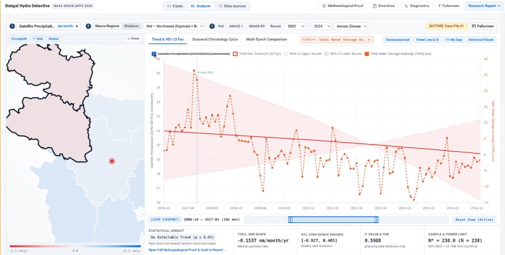
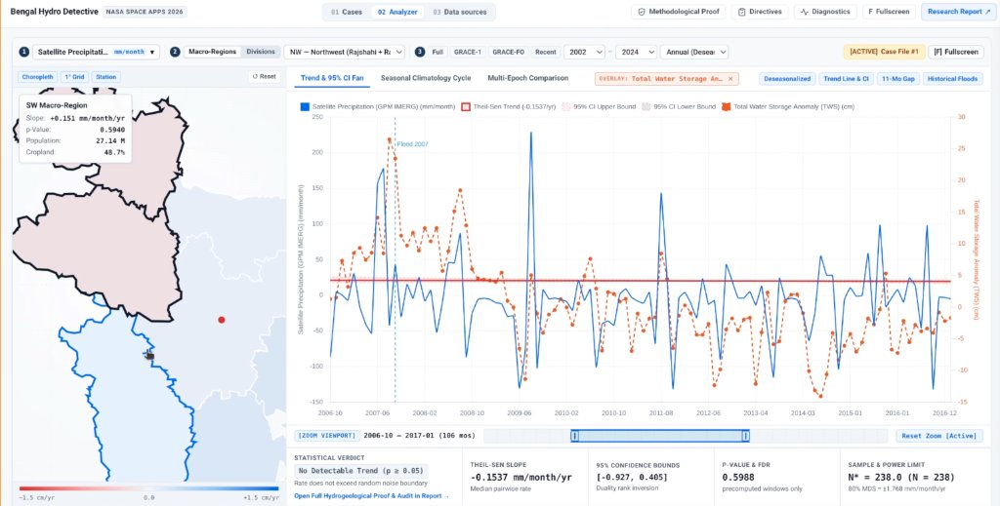
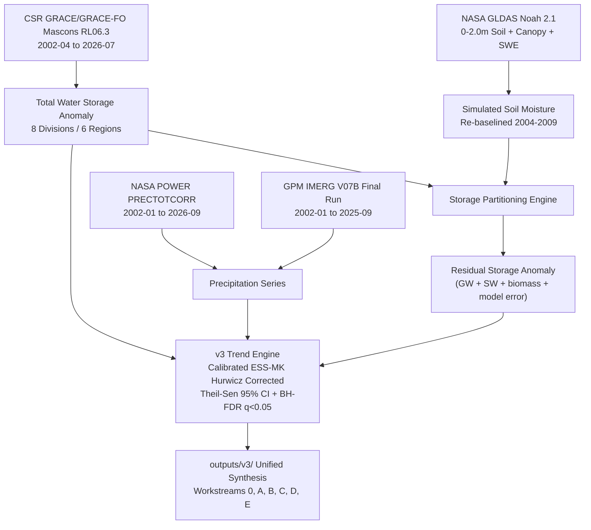

# Bengal Hydro Detective

**NASA Space Apps Challenge 2026: Be an Earth System Trend Detective!**  
**Team:** Tenstral  
**Status:** Preliminary (subject to peer review and in-situ hydrometric validation)

> [!IMPORTANT]
> **Scientific Terminology Note**  
> All results here are preliminary. Satellite gravimetry measures vertically integrated **Total Water Storage (TWS)** (surface water, soil moisture, and deeper subsurface storage combined) from CSR GRACE/GRACE-FO RL06.3 Mascons (~300 km resolution). We do not use the term **"groundwater"** for bulk TWS; it appears only in the partitioned residual label `"unpartitioned residual (groundwater + surface water + biomass + model error)"`. Attribution statements are phrased as **"consistent with"** rather than causal proof.

---

## Why This Matters

Bangladesh receives heavy monsoon rain every year, yet 24 years of NASA satellite gravimetry (2002–2026) show steady water storage loss across northern agricultural regions (`-1.25 cm/yr` in the Northwest). At the same time, satellite rainfall records show no detectable downward trend, pointing to dry-season Boro rice irrigation pumping rather than failing monsoons.

**Bengal Hydro Detective** pairs a calibrated 24-year Python analysis pipeline with a 100% client-side, offline-capable web workbench so students, researchers, and judges can test these claims directly in the browser.

---

## Major Pieces

### 1. Interactive Workbench (`index.html`)
Implements Dr. James Acker's 5-step trend workflow directly in browser JavaScript with zero backend dependency:
1. Pick a Variable: CSR GRACE/GRACE-FO TWS, GPM IMERG V07B precipitation, NASA POWER reanalysis, GLDAS Noah/VIC root-zone soil moisture, partitioned subsurface residual, ETCCDI 1-day extreme rainfall (`Rx1day`), MODIS Aqua AOD, AERONET Dhaka AOD, AIRS temperature & water vapor, and OMI tropospheric NO₂.
2. Pick a Region: Interactive map covering 5 macro-regions, the National composite, and 8 administrative divisions, with choropleth slopes, 1°/0.25° grid overlay, and Dhaka AERONET station marker.
3. Pick a Window & Season: Custom year range (2002–2026), 4 baseline presets (`Full`, `GRACE-1`, `GRACE-FO`, `Recent`), and seasonal aggregation.
4. Inspect the Series: Chart.js view with Theil-Sen slope line, 95% confidence fan, 2017–2018 11-month satellite gap shading, flood markers, dual-series overlay, timeline zoom brush, and desktop `Ctrl + Scroll` zoom / `Shift + Scroll` pan.
5. Check Statistical Rigor: Live Hurwicz-corrected Effective-Sample-Size Mann-Kendall (ESS-MK) engine, Student/Scientist view modes, 7 guided case studies, and slide-over drawers for Methodological Proof, Statistical Diagnostics, and Stakeholder Directives.

### 2. Workbench Screenshots


*Figure 1: Dual-series overlay (GPM IMERG precipitation with Total Water Storage Anomaly), 95% confidence envelope, Flood 2007 marker, timeline zoom brush (`2006-10` to `2017-01`), and live statistical verdict strip.*


*Figure 2: Interactive choropleth map tooltip displaying regional Theil-Sen slope, p-value, population (`27.14 M` in SW), and cropland share (`48.7%`) alongside the dual-axis time series.*

### 3. Research Report (`report.html`) & Pitch Deck (`demo.html`)
- **`index.html`**: Main 5-step workbench and 7 guided case studies.
- **`report.html`**: Full 24-year Bangladesh water reserve audit with cross-links back to live workbench views.
- **`demo.html`**: Interactive presentation deck for live walkthroughs.

**Quick Launch (Offline or Local Server):**
```bash
python3 -m http.server 8000
# Open http://localhost:8000 in a browser, or open index.html directly
```



---

## Key Scientific Findings (2002–2026)

### Four Analytical Windows
Every window is tested under its own Benjamini-Hochberg False Discovery Rate family ($m = 84$ tests per window):

| Window | Period | Months | Role | National TWS [95% CI] | NW TWS [95% CI] | Calibrated Verdict (ESS-MK) |
|---|---|:---:|---|:---:|:---:|---|
| `full_record` | 2002-04 to 2026-07 | 257 | Primary | -0.51 [-0.66, -0.38] | -1.25 [-1.50, -1.02] | **Significant decrease** (FDR $q < 0.0001$) |
| `grace_era` | 2002-04 to 2017-06 | 161 | Pre-gap baseline | -0.68 [-0.92, -0.45] | -1.56 [-1.96, -1.17] | **Significant decrease** (FDR $q < 0.0001$) |
| `grace_fo_era` | 2018-06 to 2026-07 | 96 | Single-era check | -0.47 [-1.50, +0.53] | -1.67 [-3.32, +0.06] | No detectable trend (CI includes zero) |
| `recent_2020` | 2020-01 to 2026-07 | 79 | Short sensitivity window | -1.02 [-2.53, +0.51] | -2.93 [-4.97, -0.78] | Method-dependent ($p = 0.0107$, FDR $q = 0.0772$) |

### Core Workstreams (`outputs/v3/`)
- Gap Calibration & Offset Checks (`full_record/`): A 2,000-run Monte Carlo simulation under real missing-month gaps confirms Hurwicz-corrected ESS-MK holds empirical false-positive rates at 5.0–5.8% (vs. 13–25% for Hamed-Rao). Across the June 2017 to June 2018 mission gap, a Newey-West HAC step model flags offsets in NW (`+9.15 cm`, `p = 0.028`) and Central (`+6.93 cm`, `p = 0.047`), while excluding ±6 transition months leaves no region significant; we report all three NW slopes (`-1.25`, `-1.81`, and `-1.29 cm/yr`). Paired circular block-bootstrap ($B = 9,999$) finds no detectable rate change between GRACE-1 and GRACE-FO (`+0.21 [-0.71, +1.13] cm/yr`).
- Precipitation Cross-Check (`imerg_vs_power/`): Across 285 months (2002–2025), GPM IMERG V07B correlates closely with NASA POWER (National Pearson $r = 0.8990$, Spearman $\rho = 0.9524$; NW $r = 0.9366$, $\rho = 0.9629$), and all 12 region-window tests yield `No detectable trend`. NASA POWER shows a step artifact around 2015, so `imerg` is the default rainfall source.
- Soil-Moisture Partition (`gldas_split/`): GLDAS Noah 2.1 (0–2.0 m) shows no multi-year trend in NW (`+0.05 cm/yr`, `p = 0.601`). Nearly all storage loss sits in the `"unpartitioned residual (groundwater + surface water + biomass + model error)"` (`-1.70 cm/yr` in `grace_fo_era`, `-2.59 cm/yr` in `recent_2020`, `p = 0.00001`).
- Exposure (`exposure/`): Using NASA SEDAC GPWv4 scaled to BBS 2022 (`169.8M`) and MODIS MCD12Q1 cropland cover, **108.5 million people (63.9%)** live in regions with significant storage decline:
  - Northwest: `38.81M` (`22.9%`), `74.2%` cropland (`22,990 km²`)
  - Northeast: `24.05M` (`14.2%`)
  - Central (Dhaka): `45.64M` (`26.9%`)
  - Southwest: `27.14M` (`16.0%`, no detectable trend)
  - Southeast: `34.18M` (`20.1%`, no detectable trend)
- Flood Context (`extremes/`): Major floods (2004, 2007, 2017, 2020, 2022) raise storage temporarily (`+33.1 cm` in 2004, `+41.0 cm` in 2007, `+28.4 cm` in 2020), then drain within 3 to 4 months.
- Literature Benchmark (`benchmark/`): Cross-checked against 6 published studies (Shamsudduha et al. 2012, Purdy et al. 2019, Ouyang et al. 2024, Shamsudduha & Taylor 2020, Ahmed et al. 2025 arXiv:2503.22771, Rodell et al. 2018).
- Atmospheric Sounding & Trace Gases: Includes NASA Aqua AIRS temperature and water vapor (`1.0°` regional grid, 2002–2026) and NASA Aura OMI tropospheric NO₂ (`0.25°` regional and divisional grid, 2004–2026, paired with MODIS Aqua AOD in Case File #7).

---

## How to Run & Verify

All outputs under `outputs/v3/` are committed and ready to inspect. To run the test suite or regenerate outputs:

```bash
git clone https://github.com/Tenstral/nasa-2026-earth-detective.git
cd nasa-2026-earth-detective
pip install -r requirements.txt

# Run Python and JS/E2E verification suites
python3 -m unittest discover tests
node --test tests/drawers.test.mjs tests/js/*.test.mjs tests/launch_slide.test.mjs
```

To rerun the pipeline from raw CSR GRACE/GRACE-FO NetCDF data, set `data_paths.grace_mascons` in `config.json` (or pass `--grace-nc <path>`) and store NASA Earthdata credentials in `~/.netrc` or `EARTHDATA_USERNAME` / `EARTHDATA_PASSWORD`:

```bash
python3 run_all.py                      # Default: GPM IMERG V07B
python3 run_all.py --rain-source power  # Historical comparison with NASA POWER
```

---

## Data Attribution

1. **GRACE/GRACE-FO Mascons**: Save, H., Bettadpur, S., & Tapley, B. D. (2016), *J. Geophys. Res. Solid Earth*, 121(10), 7547–7569.
2. **GPM IMERG**: Huffman, G. J., et al. (2020), GPM IMERG V07B, NASA GES DISC.
3. **NASA POWER**: Sparks, A. H. (2018), *J. Open Source Softw.*, 3(30), 1035.
4. **GLDAS Noah**: Rodell, M., et al. (2004), *Bull. Amer. Meteor. Soc.*, 85(3), 381–394.
5. **NASA SEDAC GPWv4**: CIESIN, Columbia University (2018), *Gridded Population of the World v4*.
6. **MODIS Land Cover**: Friedl, M., & Sulla-Menashe, D. (2019), *MCD12Q1 V006*, NASA EOSDIS LP DAAC.
7. **AIRS & OMI**: Aumann et al. (2003, 2018), Susskind et al. (2014), Krotkov et al. (2016), Levelt et al. (2018).
