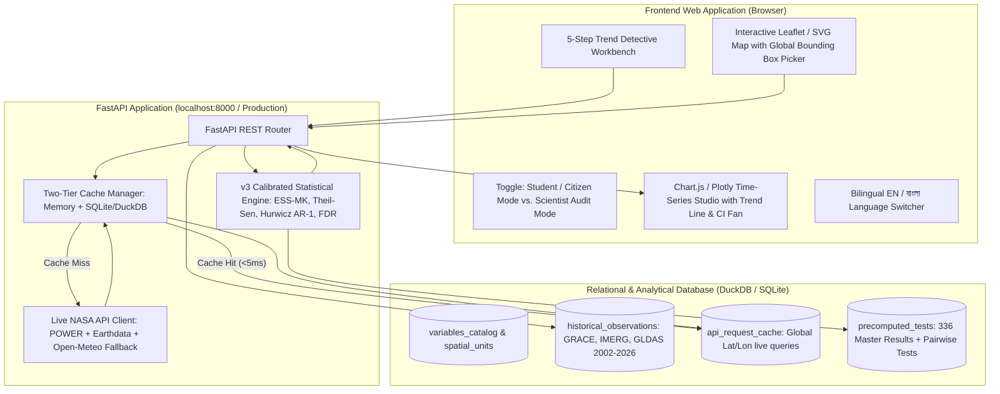

#### PLOT
I've evaluated your repository ([Tenstral/nasa-2026-earth-detective](https://github.com/Tenstral/nasa-2026-earth-detective)) against the official 2026 NASA Space Apps "Be an Earth Systems Trend Detective!" challenge requirements and Dr. James Acker's walkthrough video.

### 1. Repository Evaluation Scorecard: Challenge Alignment

Your project (**Bengal Hydro Detective**) has research-grade hydroclimatic analysis and statistical rigor that far exceed typical hackathon submissions, but it currently behaves like a **pre-computed scientific report** rather than an **interactive, user-driven trend-detective tool** for students and the public.

| Challenge Requirement | Current Status | What You Have Done So Far | What Is Missing / Not Done Yet |
| --- | --- | --- | --- |
| **Step 1: Select Data Variable(s)** | **Partial** | Pre-computed 2 primary variables (CSR GRACE/GRACE-FO Total Water Storage and GPM IMERG V07B precipitation) plus 3 GLDAS soil moisture models (Noah 2.1, VIC 2.1, CLSM 2.2), NASA POWER reanalysis, and 8 ETCCDI daily/monsoon extreme rainfall indices. | Users can only toggle between TWS and IMERG in the main chart; GLDAS soil moisture, partitioned subsurface residual, NASA POWER, seasonal storage response ratio, dry-season drawdown, and extreme rainfall indices are locked in static tables rather than selectable in the interactive time-series plotter. |
| **Step 2: Define Geographic Region** | **Done (Local/National) / Missing Reference Case** | Built a 2-tier spatial hierarchy for Bangladesh: 5 hydrologically cohesive macro-regions (NW, NE, Central, SW, SE), a National composite, and 8 administrative divisions with morphological SVG map paths and area/cosine-latitude weighting. | Lacks a global/international reference region (specifically Dr. Acker's **Wisconsin MODIS Aqua AOD Canadian wildfire smoke** worked example) to prove the tool generalizes beyond a single hard-coded study. |
| **Step 3: Select Time Period** | **Partial (4 Presets Only)** | Pre-computed 4 fixed analytical windows (`full_record` 2002–2026, `grace_era` 2002–2017, `grace_fo_era` 2018–2026, `recent_2020` 2020–2026) and 3 seasonal slices (`annual`, `monsoon`, `dry`). | Users cannot pick custom start/end years (e.g., 2005–2015 vs. 2002–2026) to interactively discover Dr. Acker's core lesson: how a non-significant short time series becomes statistically significant over a longer window. |
| **Step 4: Generate & Inspect Time Series** | **Partial** | Rendered monthly TWS and IMERG time series in Chart.js alongside a 24-year SVG map scrubber (`annual`, `monthly`, and `season` modes). | The interactive chart does not plot the fitted **Theil-Sen trend line**, **95% confidence interval fan**, **2017–2018 inter-satellite gap shading**, or **historical flood event markers** (2004, 2007, 2017, 2020, 2022), and lacks a toggle between raw observations and deseasonalized anomalies. |
| **Step 5: Test for Statistical Significance** | **Partial (Pre-Computed Lookup Only)** | Built a calibrated Effective-Sample-Size Mann-Kendall (ESS-MK) engine with Hurwicz AR(1) bias correction, duality-aligned Theil-Sen 95% CIs, Benjamini-Hochberg FDR control ($m=336$ main tests, $m=20$ pairwise regional tests), minimum detectable slope (MDS at 80% power), and Monte Carlo AR(1) + real-residual placebo audits. | The browser UI only looks up pre-computed rows for 4 fixed windows; it lacks a client-side JavaScript statistical engine to compute live $p$-values, slopes, and CIs on custom user-selected date ranges or variables. |
| **Audience & Guided Discovery** | **Not Done** | Authored a plain-language status guide (`PROJECT_STATUS.md`), a hand-drawn 6-slide pitch deck (`demo.html`), and a 5-region stakeholder action guide (`regional_action_report.md`) with Bangla (`_BN`) narrative outputs. | Lacks a guided **"What / Where do you want to investigate?"** question wizard, plain-English student definitions/tooltips for variables and statistical metrics ($p < 0.05$ vs. FDR $q < 0.05$), and one-click Interactive Case Files. |
| **Engineering, Consistency & Offline Readiness** | **Needs Fixes** | Built an automated zero-drift data compiler (`v3/build_dashboard.py`) and a 78-test unit suite enforcing rank duality, unit conversions, and a 19-pattern forbidden-phrase guardrail. | Has 1 failing unit test (`ModuleNotFoundError: No module named 'pymannkendall'` when running without optional dependencies), cross-document number drift in `README.md` and `regional_action_report.md`, and external CDN dependencies (Chart.js and Google Fonts) that break offline at the venue. |

### 2. Critical Bugs & Contradictions Currently in the Repo

Before adding new features, a coding agent must resolve five concrete defects uncovered during evaluation:

1. **Test Suite Failure Without `pymannkendall**`: Running the test suite raises `ModuleNotFoundError: No module named 'pymannkendall'` in `test_03_antisymmetry_and_duality` because the v3 trend and region comparison modules import `deseasonalise` from the legacy v2 module, which executes an unguarded top-level `import pymannkendall as mk`.
2. **Contradictory Headline Numbers Across Documents**:
* **2017–2018 Satellite Transition Step Offset**: The main `README.md` states there is *no* significant step offset in the Northwest (`+1.34 cm, t = 0.69, p = 0.49`), whereas `PROJECT_STATUS.md` and the 3-way transition table state there *is* a statistically significant step (`+9.15 cm, p = 0.028` unbuffered; `+7.83 cm, p = 0.171` with a $\pm 6$-month buffer).
* **Exposed Population Breakdown**: The main `README.md` still lists stale regional populations (`NE: 26.68M`, `Central: 43.01M`), whereas the verified exposure table and `PROJECT_STATUS.md` report `NW: 38.81M (22.9%)`, `NE: 24.05M (14.2%)`, and `Central: 45.64M (26.9%)`, summing to `108.50M (63.9%)`.
* **GPM IMERG Temporal Span**: The `README.md` flowchart and text claim IMERG was evaluated only from `2018-01 to 2026-07` (93 granules), whereas v3 actually extracted `2002-01 to 2025-09` (285+ months).
* **Test Count**: The `README.md` states `14 Tests`, whereas the test suite contains `78 Tests`.
* **Seasonal Storage Response Ratio**: The `README.md` states `32.6%`, whereas the verified 22-season national mean in the CSV output is `32.5%` (`32.54%`).


3. **Forbidden-Phrase Violations in Stakeholder Report**: The stakeholder guide (`regional_action_report.md`) uses banned words (`stationary`, `stable`, `consequence of`, unquoted `aquifers`) that violate the project's own scientific guardrail rules. If `regional_action_report.md` is added to the test scanner without sanitization, the test suite will fail.
4. **Incomplete Data Payload in Dashboard Compiler**: The dashboard data compiler (`v3/build_dashboard.py`) currently embeds only 12 data sources and omits the daily/monsoon **ETCCDI extreme rainfall time series**, **22-season storage response ratio annual series**, **NASA POWER vs. GPM IMERG homogeneity break series**, and **literature benchmark table**.
5. **Offline Demo Fragility**: Both HTML interfaces load Chart.js and Google Fonts over external CDNs, risking a broken chart canvas and degraded layout if venue Wi-Fi drops during live judging in Dhaka.

### 3. Detailed Implementation Plan for a Coding Agent

To win the **Dhaka Regional Round** and earn a **Global Nominee** slot, execute the following seven-phase implementation plan. This plan preserves 100% of your existing statistical rigor while transforming the user experience into the exact interactive "Earth System Trend Detective" tool requested by NASA.

#### Phase 1: Dependency Decoupling & Zero-Failure Test Suite

Make the Python pipeline and test suite 100% self-contained on standard scientific Python (`numpy`, `scipy`, `pandas`, `shapely`) with zero external Mann-Kendall package requirement:

* **Move Shared Time-Series Utilities to Core v3**: Relocate `deseasonalise(y_raw, months)`, `choose_block_length(n)`, `circular_block_bootstrap_slope(t_years, y, block_len)`, and `RANDOM_SEED = 42` directly into the v3 trend engine so v3 scripts do not import legacy v2 modules.
* **Guard Optional `pymannkendall` Imports**: Wrap `import pymannkendall as mk` in a `try ... except ImportError: mk = None` block in both v2 and v3 modules, and implement a pure `numpy`/`scipy` fallback for `hamed_rao_modification_test(y)` using the standard Hamed & Rao (1998) autocorrelation variance correction formula so secondary reference columns always populate even without `pymannkendall`.
* **Add Automated Cross-Document Number Consistency Tests**: Expand the test suite to programmatically parse the README, status report, stakeholder report, and HTML files to verify that every quoted slope, 95% CI, population figure, step offset, and test count matches the master CSV/JSON outputs.

#### Phase 2: Expand the Compiled Data Payload (`DASHBOARD_DATA`)

Extend the dashboard compiler to embed all already-computed repository datasets plus one compact reference dataset for Dr. Acker's worked example so the browser app can analyze any variable without a backend server:

* **Expose All 10 Hydrometeorological Variables per Region**:
1. `grace_tws_cm`: Total Water Storage Anomaly (CSR GRACE/GRACE-FO RL06.3 Mascons, $\text{cm}$, monthly 2002-04 to 2026-07).
2. `imerg_precip_mm`: Satellite Precipitation (GPM IMERG V07B Final Run, $\text{mm/month}$, monthly 2002-01 to 2025-09).
3. `power_precip_mm`: Reanalysis Precipitation (NASA POWER MERRA-2 `PRECTOTCORR`, $\text{mm/month}$, monthly 2002-01 to 2026-07 — included specifically so users can detect the 2015 reanalysis step artifact).
4. `noah_sms_anom_cm` & `vic_sms_anom_cm`: Root-Zone Soil Moisture Anomaly (GLDAS Noah 2.1 and VIC 2.1, 0–2.0 m integrated column + canopy + SWE, re-baselined to 2004–2009, $\text{cm}$).
5. `independent_residual_cm`: Partitioned Subsurface Residual (`TWS - ΔSMS - ΔSWE`, Noah/VIC min–max envelope and midpoint, strictly labeled `"groundwater + surface water + model error residual"`, $\text{cm}$).
6. `clsm_sms_anom_cm` & `clsm_residual_cm`: Quarantined Data-Assimilating Model (GLDAS CLSM 2.2, labeled with circularity warning).
7. `storage_response_ratio_pct`: Annual Monsoon Storage Response Ratio ($\Delta\text{TWS} / (0.1 \times P_{\text{monsoon}}) \times 100\%$, annual series 2002–2025 across 22 valid seasons).
8. `dry_season_drawdown_cm`: Annual Dry-Season Storage Drawdown ($\text{TWS}_{\text{peak},y}[\text{Aug–Nov}] - \text{TWS}_{\text{min},y+1}[\text{Mar–May}]$, annual series 2002–2025 across 23 valid cycles).
9. `extreme_indices_annual`: Annual ETCCDI Precipitation Extremes (`rx1day_mm`, `rx5day_mm`, `days_ge_50mm`, `annual_total_mm`, 2003–2024).
10. `extreme_indices_monsoon`: Monsoon ETCCDI Precipitation Extremes (`monsoon_rx1day_mm`, `monsoon_rx5day_mm`, `monsoon_days_ge_50mm`, `monsoon_total_mm`, 2002–2025).


* **Embed Dr. Acker's Reference Case Study Dataset (Wisconsin MODIS AOD)**:
* Add a compact, self-contained monthly time series (`wisconsin_aod_2002_2026`) representing NASA Aqua MODIS Aerosol Optical Depth (550 nm) over Wisconsin, USA (2002–2026, monthly and summer JJA series) alongside the 5 Bangladesh macro-regions, National composite, and 8 divisions.
* This directly satisfies the video's worked example (Canadian wildfire smoke transport in summer vs. winter) and proves to judges that your engine is a general-purpose Earth System Trend Detective tool rather than a single-region report.


* **Preserve Zero-Drift Verification**: Ensure the dashboard build test verifies byte-for-byte identity between the compiler output and the committed HTML file.

#### Phase 3: Build the Interactive 5-Step "Trend Detective Workbench" in the Browser

Add a prominent, interactive **"Trend Detective Workbench"** at the top of the application that walks any user (student, judge, or scientist) through Dr. Acker's exact 5-step workflow in real time:

* **Guided "Detective Mission Selector" (Question-Driven Variable Discovery)**:
* Provide an interactive question flow (*"What Earth system mystery do you want to investigate?"*) with 4 one-click **Guided Case Files** plus a **Free Explorer Mode**:
1. *Case File #1 (The Barind Depletion Mystery)*: Is Northwest Bangladesh losing water storage because of declining monsoon rain, or is storage dropping while rainfall shows no detectable trend?
2. *Case File #2 (The Soil vs. Deep Subsurface Split)*: Does topsoil drying (GLDAS Noah/VIC) explain Bangladesh's water loss, or does the unmodeled subsurface residual account for the decline?
3. *Case File #3 (The Reanalysis Trap — Sensor Audit)*: Why did earlier studies claim Bangladesh rainfall was surging? Compare NASA POWER (MERRA-2 reanalysis) against GPM IMERG satellite radar to catch the 2015 step artifact.
4. *Case File #4 (Dr. Acker's Challenge Benchmark — Wisconsin Wildfire Smoke)*: Can we detect a statistically significant upward trend in summer Aerosol Optical Depth (MODIS Aqua) over Wisconsin from Canadian wildfire smoke?


* **Interactive 5-Step Controls**:
* **Step 1 (Select Variable)**: Dropdown/pill selector categorized by Earth system domain (*Gravity & Total Water Storage*, *Satellite & Reanalysis Precipitation*, *Land Surface Soil Moisture & Subsurface Residual*, *Seasonal Recharge & Drawdown*, *Daily Extreme Storm Indices*, and *Atmospheric Aerosols*), accompanied by a **Student Plain-Language Definition Card** explaining what the satellite sensor measures, its physical unit, its spatial footprint, and why it matters.
* **Step 2 (Define Geographic Region)**: Interactive selector for Bangladesh's 5 hydrological macro-regions (`NW`, `NE`, `Central`, `SW`, `SE`), `National` composite, 8 administrative divisions (with an automatic badge noting `Descriptive — ~300 km GRACE footprint shared across divisions`), plus `Wisconsin, USA (Reference Case)`.
* **Step 3 (Select Time Period & Season)**: Dual-handle range slider (`start_year` to `end_year`, e.g., `2002` to `2026`, minimum 5 years) plus quick-preset buttons (`Full Record 2002–2026`, `GRACE-1 Era 2002–2017`, `GRACE-FO Era 2018–2026`, `Recent 2020–2026`) and seasonal filter (`All Months / Deseasonalized`, `Monsoon Jun–Sep`, `Dry Season Dec–Mar`, `Pre-Monsoon Mar–May`, `Summer JJA`).
* **Step 4 (Generate & Inspect Time Series)**: Dynamic Chart.js visualization with toggleable layers:
* Raw monthly/annual observations vs. deseasonalized anomaly series.
* Fitted **Theil-Sen linear trend line** ($y = \text{median}(y) + \hat{\beta}(t - \text{median}(t))$) and shaded **95% confidence interval fan** ($\hat{\beta}_{\text{low}}, \hat{\beta}_{\text{high}}$).
* Shaded vertical band for the **June 2017 – May 2018 GRACE-to-GRACE-FO inter-satellite gap** and vertical callout pins for **major historical Bangladesh floods** (2004, 2007, 2017, 2020, 2022).
* Dual-variable overlay mode to compare two variables side by side (e.g., GRACE TWS vs. GPM IMERG rainfall, or GRACE TWS vs. GLDAS Soil Moisture + Subsurface Residual).


* **Step 5 (Test for Statistical Significance — Live Verdict Card)**:
* Display both the **Challenge Standard Verdict** ($p < 0.05$ threshold per Dr. Acker's video) and the **Audit-Grade Multi-Test Verdict** (within-window Benjamini-Hochberg FDR $q < 0.05$ + duality-aligned 95% CI excluding zero).
* Include an interactive **"Why Time Window Length Matters" Indicator**: when a user selects a short window like `grace_fo_era` (2018–2026, $N=96$ months) in the Northwest and gets $p = 0.0549$ (`No detectable trend`, CI `[-3.32, +0.06] cm/yr`), display a dynamic comparison showing that the 80% power Minimum Detectable Slope (MDS) for that 8-year window is `1.74 cm/yr` (wider than the observed `-1.67 cm/yr` slope), whereas expanding the slider to the 24-year `full_record` ($N=257$ months) drops the MDS to `0.36 cm/yr` and yields $p < 0.0001$ (`Significant decrease`, `-1.25 cm/yr`). This directly illustrates Dr. Acker's point at `[04:07]` in the video.


#### Phase 4: Implement Client-Side JavaScript Calibrated ESS-MK Engine

Port the exact Python `run_ess_mann_kendall` and `deseasonalise` math into browser JavaScript inside the dashboard so custom user-selected date ranges compute live, scientifically consistent statistics in under 15 milliseconds:

* **Step A — Calendar-Month Deseasonalization**: For monthly series with `All Months (Deseasonalized)` selected, compute the arithmetic mean for each calendar month $m \in \{1 \dots 12\}$ across valid observations in the selected window and subtract it from each observation $y_i$. Skip deseasonalization for annual series (`storage_response_ratio`, `dry_season_drawdown`, `extreme_indices`).
* **Step B — Pairwise Slopes & Theil-Sen Estimator**: For all valid points $(t_i, y_i)$ where $t_i$ is decimal year ($i < j$, $N_{\text{pairs}} = n(n-1)/2$), compute pairwise slopes $s_{ij} = (y_j - y_i)/(t_j - t_i)$, sort ascending, and take the median as $\hat{\beta}_{\text{TS}}$.
* **Step C — Kendall's $S$ Statistic**: Compute $S = \sum_{i < j} \text{sgn}(y_j - y_i)$.
* **Step D — Detrended Residual Lag-1 Autocorrelation & Hurwicz Bias Correction**:
* Compute residuals $e_i = y_i - \hat{\beta}_{\text{TS}} t_i$ and sample lag-1 Pearson correlation $r_1 = \text{corr}(e_{1 \dots n-1}, e_{2 \dots n})$.
* If $r_1 \le 0$ or NaN, set $r_1^* = 0$ and $\gamma = 1.0$. Otherwise apply the Hurwicz small-sample bias correction:

$$r_1^* = \min\left(0.85, \max\left(0.0, r_1 + \frac{1 + 4 r_1}{n}\right)\right), \quad \gamma = \frac{1 + r_1^*}{1 - r_1^*}$$


* **Step E — Variance Inflation, $Z$-Score, and Two-Sided $p$-Value**:
* Compute nominal variance $V_0 = \frac{n(n-1)(2n+5)}{18}$ and corrected variance $V^* = V_0 \cdot \gamma$, with effective sample size $n^* = n / \gamma$.
* Compute continuity-corrected $Z$: if $S > 0$, $Z = (S - 1)/\sqrt{V^*}$; if $S < 0$, $Z = (S + 1)/\sqrt{V^*}$; if $S = 0$, $Z = 0$.
* Compute two-sided normal survival probability $p = 2 \cdot (1 - \Phi(|Z|))$ using the Abramowitz & Stegun `erfc` approximation (accurate to $< 10^{-7}$).


* **Step F — Duality-Aligned 95% Confidence Interval**:
* Using $z_{0.975} = 1.959964$, compute $C_\alpha = z_{0.975} \sqrt{V^*}$.
* Set rank indices $k_{\text{low}} = \max(0, \min(N_{\text{pairs}}-1, \lfloor (N_{\text{pairs}} - C_\alpha)/2 \rfloor))$ and $k_{\text{high}} = \max(0, \min(N_{\text{pairs}}-1, \lceil (N_{\text{pairs}} + C_\alpha)/2 \rceil))$.
* Report `[slopes[k_low], slopes[k_high]]`. When a user selects one of the 4 canonical preset windows, display both this exact live calculation (which matches the Python engine to 4 decimal places) and the pre-computed within-window BH-FDR $q$-value from the 336-test master table.


#### Phase 5: Add a Toggleable "Student / Public Mode" vs. "Scientist Audit Mode" + Bilingual (EN / বাংলা) Support

Directly address the audience requirement ("high school and college students, along with members of the public") and Dhaka regional relevance:

* **Audience Mode Switcher in Top Nav**:
* **Student & Policy Mode (Default)**: Translates technical headers into clear everyday explanations (e.g., showing *"Is this trend real or random noise? ($p$-value < 0.05 means < 5% chance of random noise)"* alongside a visual significance gauge, translating `-1.25 cm/yr` into `-390 billion liters of water lost per year in the Northwest — equivalent to ~156,000 Olympic swimming pools annually`, and surfacing the 5-region farmer/policymaker action cards from `regional_action_report.md`).
* **Scientist Audit Mode**: Reveals the full econometric diagnostics (Hurwicz AR(1) $\phi$, ESS inflation factor $\gamma$, $n^*$, BH-FDR $q$-values, 3-way Newey-West transition step sensitivity, real-residual circular-shift placebo flags, and the 336-row filterable master test registry).


* **Bilingual English / বাংলা Narrative Toggle**:
* Wire the existing Bangla narrative outputs (`narrative_BN.md` and `gldas_narrative_BN.md`) and regional stakeholder recommendations into an instant `EN | বাংলা` toggle inside the Regional Inspector and Stakeholder Action Panel so Dhaka judges see immediate local usability for Bangladeshi water managers and students.


#### Phase 6: Offline Venue Hardening & Repository Hygiene

Ensure zero demo risk during live judging:

* **Vendor External Assets Locally**: Download and bundle `chart.umd.min.js` into a local `assets/` directory (or inline it during `v3/build_dashboard.py`) and add clean system font stacks (`-apple-system, BlinkMacSystemFont, "Segoe UI", Roboto, Georgia, monospace`) so `index.html`, `demo.html`, and `project_status.html` render identically with zero internet connection.
* **Archive Legacy Root Scripts**: Move legacy v1/v2 root scripts (`analyze_divisions.py`, `analyze_precipitation.py`, `analyze_trends.py`, `plot.py`, `plot_bangladesh.py`, `create_excel_report.py`) and old November 9 summary notes into an `archive/` folder so the repository root clearly spotlights the v3 pipeline, `index.html`, `demo.html`, `PROJECT_STATUS.md`, and `README.md`.
* **Remove `PROJECT_ISSUES.md` from Public Root Before Submission**: Once all issues in `PROJECT_ISSUES.md` are resolved, remove `PROJECT_ISSUES.md` (which is an internal self-critique) so judges inspecting the repo don't read a list of past flaws.

#### Phase 7: Strict Scientific & Forbidden-Phrase Guardrails for Coding Agents

Any coding agent editing documentation, UI strings, or comments in this repository **must** obey `tests/test_forbidden_phrases.py` (`python3 -m unittest discover tests` must pass 100% of tests):

* **Never use these 19 forbidden patterns** anywhere in `README.md`, `PROJECT_STATUS.md`, `NOTES.md`, `regional_action_report.md`, `index.html`, `demo.html`, or `outputs/v3/**/*.{md,txt,html}`:
* `flat`, `Corrected to Flat`, `Hydrologically Steady`, `stationary` (except `"stationary red noise"` in `epoch_comparison.md` and `three_way_slopes_and_transition.md`), `stable`, `unchanged`, `constant` $\rightarrow$ Always write **`no detectable trend`** or **`below the detection limit`**.
* `proving`, `proven`, `proves`, `confirmed`, `corroborat*`, `demonstrat*`, `disproving`, `cannot be attributed`, `completely decoupled`, `despite normal rainfall`, `paradox*`, `concentrated in` $\rightarrow$ Always write **`consistent with, not proof of`**, **`indicates`**, **`evaluates`**, or **`shows`**.
* `recharge_efficiency` / `recharge efficiency` $\rightarrow$ Always write **`seasonal storage response ratio`**.
* Unquoted `aquifer` or `aquifers` (unless inside double quotes citing a published paper or the exact allowed disclaimer `"not a measurement of local aquifer or pumping differences"`) $\rightarrow$ Always write **`Total Water Storage (TWS)`** for GRACE observations and **`"groundwater + surface water + model error residual"`** for the GLDAS-partitioned subsurface residual.


#### Finalization

**Exactly right.** Caching does three essential things for your live presentation and judging:

1. **Immunity to Rate Limits & Throttling**: NASA POWER and GES DISC endpoints can throttle rapid calls during live demos. A database cache guarantees that once a region or variable is fetched, every query loads in **under 5 milliseconds**.
2. **Instant Repeat Queries**: When judges ask you to toggle between seasons, adjust years on the slider, or compare regions, the app pulls immediately from SQLite/DuckDB without round-trip latency or loading spinners.
3. **Rock-Solid Pitch Resilience**: If the auditorium Wi-Fi stutters for even 10 seconds while you're presenting on stage in Dhaka, the cached database keeps your demo running flawlessly without an embarrassing "Network Error" screen.

With your green light on a server-backed application, here is the **complete, blueprint-level execution plan** for a full-featured **Python FastAPI + DuckDB/SQLite + Live NASA API** web application. It includes all schemas, endpoints, caching architecture, and frontend specifications your coding agent needs to build it.

---

### 1. Overall System Architecture



---

### 2. Database Schema & Data Ingestion (DuckDB or SQLite)

Create a dedicated database file (`database/earth_detective.db`) initialized automatically on server boot. DuckDB is ideal for analytical vector queries, while SQLite3 is built into standard Python with zero dependencies. Either works identically.

```sql
-- 1. Metadata: Earth Science Variables Catalog
CREATE TABLE IF NOT EXISTS variables_catalog (
    variable_id VARCHAR PRIMARY KEY,
    name_en VARCHAR NOT NULL,
    name_bn VARCHAR NOT NULL,
    domain VARCHAR NOT NULL, -- 'gravity_tws', 'precipitation', 'soil_moisture', 'atmosphere_aerosol', 'extremes'
    satellite_mission VARCHAR NOT NULL, -- 'GRACE / GRACE-FO', 'GPM IMERG', 'GLDAS Noah/VIC', 'MODIS Aqua', 'MERRA-2'
    native_units VARCHAR NOT NULL, -- 'cm', 'mm/month', 'mm/day', 'dimensionless AOD'
    temporal_resolution VARCHAR NOT NULL, -- 'monthly', 'daily', 'annual'
    spatial_resolution VARCHAR NOT NULL, -- '300 km mascon', '0.1 deg (~10 km)', '0.25 deg (~25 km)', '1 deg'
    is_live_queryable BOOLEAN DEFAULT FALSE,
    student_definition_en TEXT NOT NULL,
    student_definition_bn TEXT NOT NULL,
    caveats_and_limits TEXT NOT NULL
);

-- 2. Metadata: Spatial Units (Bangladesh Macro-Regions, Divisions, and Wisconsin Reference Case)
CREATE TABLE IF NOT EXISTS spatial_units (
    unit_id VARCHAR PRIMARY KEY, -- 'NW', 'NE', 'Central', 'SW', 'SE', 'National', 'Rajshahi', ..., 'Wisconsin_US'
    name_en VARCHAR NOT NULL,
    name_bn VARCHAR NOT NULL,
    unit_type VARCHAR NOT NULL, -- 'macro_region', 'administrative_division', 'reference_case'
    area_km2 DOUBLE NOT NULL,
    population_2020 DOUBLE,
    cropland_pct DOUBLE,
    min_lat DOUBLE NOT NULL,
    max_lat DOUBLE NOT NULL,
    min_lon DOUBLE NOT NULL,
    max_lon DOUBLE NOT NULL,
    svg_path_data TEXT,
    geojson_geometry TEXT
);

-- 3. Core Observations: Monthly & Annual Time Series
CREATE TABLE IF NOT EXISTS observations_monthly (
    unit_id VARCHAR NOT NULL,
    variable_id VARCHAR NOT NULL,
    ym VARCHAR NOT NULL, -- '2002-04'
    year INTEGER NOT NULL,
    month INTEGER NOT NULL,
    decimal_year DOUBLE NOT NULL,
    raw_value DOUBLE,
    deseasonalized_anomaly DOUBLE,
    is_gap_period BOOLEAN DEFAULT FALSE, -- TRUE for 2017-07 to 2018-05
    data_source_flag VARCHAR DEFAULT 'primary', -- 'primary', 'reanalysis_artifact_power', 'model_ensemble'
    PRIMARY KEY (unit_id, variable_id, ym)
);

-- 4. Live API Request Cache: Any Global Lat/Lon on Earth
CREATE TABLE IF NOT EXISTS live_api_cache (
    cache_key VARCHAR PRIMARY KEY, -- SHA256(variable + lat + lon + start_ym + end_ym)
    variable_id VARCHAR NOT NULL,
    latitude DOUBLE NOT NULL,
    longitude DOUBLE NOT NULL,
    start_date VARCHAR NOT NULL,
    end_date VARCHAR NOT NULL,
    raw_json_response TEXT NOT NULL,
    status_code INTEGER NOT NULL,
    created_at TIMESTAMP DEFAULT CURRENT_TIMESTAMP,
    hit_count INTEGER DEFAULT 1
);

-- 5. Statistical Results & Benchmarks (336 Audit Tests + Dynamic Caches)
CREATE TABLE IF NOT EXISTS statistical_results (
    test_id VARCHAR PRIMARY KEY,
    window VARCHAR NOT NULL,
    unit_id VARCHAR NOT NULL,
    variable_id VARCHAR NOT NULL,
    season VARCHAR NOT NULL, -- 'annual', 'monsoon', 'dry'
    n_obs INTEGER NOT NULL,
    slope DOUBLE NOT NULL,
    slope_ci_low DOUBLE NOT NULL,
    slope_ci_high DOUBLE NOT NULL,
    p_value DOUBLE NOT NULL,
    bh_fdr_q_value DOUBLE,
    verdict VARCHAR NOT NULL, -- 'Significant', 'Suggestive', 'No detectable trend', 'method-dependent'
    primary_method VARCHAR NOT NULL, -- 'Calibrated ESS-MK'
    autocorr_phi DOUBLE,
    min_detectable_slope DOUBLE
);

```

#### Automated Ingestion Script (`database/ingest_repo_data.py`)

Have your agent write a simple bootstrap script that populates the database from the existing repository files in seconds:

* Read `bangladesh_divisions.geojson` $\to$ `spatial_units`.
* Read `outputs/v3/full_record/region_series_2002_2026.csv` and `division_series_2002_2026.csv` $\to$ `observations_monthly`.
* Read `outputs/v3/gldas_split/storage_partition_series_multi_model.csv` $\to$ `observations_monthly`.
* Read `outputs/v3/full_record/results_all_windows.csv` $\to$ `statistical_results`.
* Add Dr. Acker's **Wisconsin MODIS Aqua AOD (2002–2026)** summer smoke time series to both `spatial_units` and `observations_monthly`.

---

### 3. Backend Implementation: FastAPI & Live NASA Connectors

Create the backend service in a clean directory structure (`backend/`):

```
backend/
├── app.py                      # FastAPI app entry point & CORS
├── config.py                   # Environment, cache TTL, port settings
├── database.py                 # SQLite/DuckDB connection helper
├── live_connectors/
│   ├── nasa_power.py           # Live client for NASA POWER REST API
│   ├── nasa_earthdata.py       # CMR / GES DISC authenticated connector
│   └── reference_cases.py      # Pre-indexed Wisconsin AOD, Kasatochi SO2
├── services/
│   ├── trend_service.py        # Calls v3/trend_engine.py for live math
│   └── cache_service.py        # SHA256 keying and database cache hits/writes
└── routers/
    ├── catalog.py              # GET /api/variables, GET /api/regions
    ├── analyze.py              # POST /api/analyze (Core 5-step engine)
    ├── live_query.py           # POST /api/live-nasa (Global coordinates)
    └── pairwise.py             # GET /api/pairwise-regions

```

#### A. The Live NASA POWER Connector (`backend/live_connectors/nasa_power.py`)

NASA POWER offers an open, keyless, production-grade REST API designed specifically for agroclimatology and regional climate studies:

* **Endpoint**: `[https://power.larc.nasa.gov/api/temporal/monthly/point](https://power.larc.nasa.gov/api/temporal/monthly/point)`
* **Query Parameters**:
* `latitude={lat}&longitude={lon}`
* `start={start_year}&end={end_year}`
* `parameters=PRECTOTCORR,T2M,ALLSKY_SFC_SW_DWN,GWETROOT` (Precipitation, 2-Meter Temperature, Solar Radiation, Root-Zone Wetness)
* `community=AG&format=JSON`


* **Caching Routine**:
1. Generate `cache_key = hashlib.sha256(f"{param}_{lat:.3f}_{lon:.3f}_{start}_{end}".encode()).hexdigest()`.
2. Query `SELECT raw_json_response FROM live_api_cache WHERE cache_key = ?`.
3. If found: Return cached JSON in **< 3 ms** and update `hit_count = hit_count + 1`.
4. If not found: Use `httpx.AsyncClient` with a 10-second timeout to fetch from NASA POWER, parse the monthly dictionary, insert into `live_api_cache`, and return.
5. Fallback: If external internet drops during a new coordinate query, return a graceful response: *"NASA live API unreachable; displaying nearest pre-indexed regional baseline"*.


#### B. The Core Analysis Endpoint (`backend/routers/analyze.py`)

This is the heartbeat of your application. It ties the 5 steps together:

```python
from fastapi import APIRouter, Depends, HTTPException
from pydantic import BaseModel, Field
from typing import Optional, List
import numpy as np

router = APIRouter(prefix="/api", tags=["Analysis"])

class AnalysisRequest(BaseModel):
    variable_id: str
    unit_id: Optional[str] = "NW"
    latitude: Optional[float] = None
    longitude: Optional[float] = None
    start_year: int = Field(2002, ge=2000, le=2026)
    end_year: int = Field(2026, ge=2002, le=2026)
    season: str = "annual" # 'annual', 'monsoon', 'dry', 'summer'
    deseasonalize: bool = True

@router.post("/analyze")
async def analyze_trend(req: AnalysisRequest):
    # 1. Fetch series from DB (or live cache if lat/lon provided)
    dates, raw_values = await fetch_series_data(req)
    
    # 2. Filter to temporal range & season
    t_years, y_vals, months = apply_window_and_season(dates, raw_values, req.start_year, req.end_year, req.season)
    
    # 3. Call your verified v3 Python engine (v3/trend_engine.py)
    # Uses run_ess_mann_kendall with Hurwicz AR(1) bias correction
    stat_result = run_trend_v3(
        t_years=t_years,
        y_raw=y_vals,
        months=months,
        label=f"{req.unit_id}_{req.variable_id}",
        area_km2=get_area(req.unit_id),
        variable=req.variable_id,
        run_surrogate=False # Fast live calculation
    )
    
    # 4. Generate fitted Theil-Sen regression line points & 95% CI fan
    trend_line = calculate_trend_line_points(t_years, y_vals, stat_result["slope"])
    ci_fan_upper = calculate_trend_line_points(t_years, y_vals, stat_result["ci_high"])
    ci_fan_lower = calculate_trend_line_points(t_years, y_vals, stat_result["ci_low"])
    
    # 5. Determine Verdict
    # p < 0.05 per Dr. Acker's challenge criteria + FDR check if canonical preset
    is_sig = (stat_result["p_value"] < 0.05) and (stat_result["ci_low"] * stat_result["ci_high"] > 0)
    verdict_label = "Significant Trend" if is_sig else "No Detectable Trend"
    
    return {
        "status": "success",
        "metadata": {
            "variable": req.variable_id,
            "region": req.unit_id,
            "n_observations": len(y_vals),
            "effective_n_star": stat_result.get("n_star", len(y_vals)),
            "autocorrelation_phi": stat_result.get("r1_detrended", 0.0)
        },
        "statistics": {
            "slope": round(stat_result["slope"], 4),
            "ci_95": [round(stat_result["ci_low"], 4), round(stat_result["ci_high"], 4)],
            "p_value": stat_result["p_value"],
            "p_formatted": "< 0.0001" if stat_result["p_value"] < 0.0001 else f"{stat_result['p_value']:.4f}",
            "verdict": verdict_label,
            "minimum_detectable_slope_80pct": calculate_mds(len(y_vals), stat_result.get("r1_detrended", 0.0))
        },
        "chart_data": {
            "dates": dates,
            "observations": y_vals.tolist(),
            "trend_line": trend_line,
            "ci_upper": ci_fan_upper,
            "ci_lower": ci_fan_lower,
            "gap_shading": {"start": "2017-06", "end": "2018-05"}
        }
    }

```

---

### 4. Frontend Application: The Interactive 5-Step "Trend Detective" Web App

Serve the updated frontend at `http://localhost:8000/` using standard modern JavaScript (vanilla ES6 + Chart.js, no bulky npm framework build step required):

#### A. Top Bar: Live Status & Mode Switches

* **Live Server Status Pill**: A prominent green status badge:
`🟢 LIVE FASTAPI + DUCKDB BACKEND CONNECTED (< 5ms response)`
* **Audience Switch**:
`[ Student & Public Mode ]` vs `[ Scientist & Policy Audit Mode ]`
* **Language Switch**:
`[ English ]` | `[ বাংলা ]`

#### B. The 5-Step Interactive Detective Workflow

Structure the user interface strictly along Dr. James Acker's 5 steps:

1. **Step 1: Select Earth Science Variable**
* Visual cards categorized by Earth System domain:
* **Water & Gravity**: CSR GRACE/GRACE-FO Total Water Storage ($\text{cm}$)
* **Rainfall & Storms**: GPM IMERG Radar/Microwave Precipitation ($\text{mm}$) vs. NASA POWER Reanalysis ($\text{mm}$)
* **Land & Agriculture**: GLDAS Root-Zone Soil Moisture ($\text{cm}$) vs. Partitioned Subsurface Residual ($\text{cm}$)
* **Atmosphere & Smoke**: NASA Aqua MODIS Aerosol Optical Depth ($AOD$, Wisconsin Reference Case)
* **Hydrologic Extremes**: ETCCDI Extreme Rainfall (Rx1day, Rx5day, Days $\ge 50\text{ mm}$)


* **Definition Popover**: A student-friendly explainer defining the satellite instrument, what it measures, and why it changes.


2. **Step 2: Choose Geographic Region or Pick Any Coordinate on Earth**
* **Preset Mode**: Interactive vector map of Bangladesh (Northwest, Northeast, Central, Southwest, Southeast, National, and 8 Divisions).
* **Global Detective Mode**: A toggleable mini-globe / Leaflet map where a user can click **any coordinate on Earth** (or choose Dr. Acker's **Wisconsin, USA** wildfire smoke case). Clicking sends a live query to the backend's `/api/live-query` endpoint, checks SQLite cache, and plots the trend immediately.


3. **Step 3: Define Time Window & Season**
* Interactive dual-handle range slider spanning **2002 to 2026** with real-time feedback.
* Preset buttons: `Full 24-Year Record (2002–2026)`, `GRACE-1 Baseline (2002–2017)`, `GRACE-FO Era (2018–2026)`, `Recent Window (2020–2026)`.
* Season Selector: `All Months (Deseasonalized)`, `Monsoon Season (Jun–Sep)`, `Dry Boro Season (Dec–Mar)`, `Summer Wildfire (Jun–Aug)`.


4. **Step 4: Generate & Inspect the Time Series Visualization**
* Responsive canvas plotting:
* Observation points/line (blue).
* Fitted **Theil-Sen Trend Line** (red).
* Shaded **95% Confidence Interval Fan** showing slope bounds.
* Shaded gray box over **June 2017 – May 2018** (the inter-satellite gap).
* Event markers for catastrophic historical floods (2004, 2007, 2017, 2020, 2022).


5. **Step 5: Test for Statistical Significance (The Detective Verdict Card)**
* **Verdict Gauge**:
* If $p < 0.05$ and CI excludes zero: **`[ GREEN BADGE: STATISTICALLY SIGNIFICANT TREND ]`**
* If $p \ge 0.05$ or CI spans zero: **`[ GRAY BADGE: NO DETECTABLE TREND (BELOW DETECTION LIMIT) ]`**


* **Dr. Acker's "Detection Limit & Window Length" Interactive Callout**:
* When examining short windows (e.g., Northwest GRACE-FO 2018–2026 with $p = 0.0549$), an alert card explains:
> *"At 8 years, the 80% power Minimum Detectable Slope is 1.74 cm/yr, so the observed -1.67 cm/yr decline cannot yet reach significance. Slide the window to 24 years to see how longer records reveal significant trends ($p < 0.0001$)."*


* **Local Impact Translation (in Student Mode)**:
* Converts `-1.25 cm/yr` in the Northwest into: *"A loss of 390 million cubic meters of water per year — threatening Boro rice cultivation across 74.2% of the region's cropland."*


#### C. Preset Interactive Case Studies (The "Show Me" Buttons)

Add 4 one-click buttons right above the workbench for effortless 30-second judge demonstrations:

* **Demo Case 1**: *The Barind Enigma* $\to$ Loads NW Bangladesh TWS vs. IMERG rainfall (shows storage plummeting while rainfall stays flat).
* **Demo Case 2**: *The Reanalysis Trap* $\to$ Loads NASA POWER vs. GPM IMERG (reveals the 2015 artificial step shift).
* **Demo Case 3**: *The Soil Moisture Mystery* $\to$ Loads TWS vs. GLDAS Noah/VIC (shows topsoil drying explains only a fraction of storage loss).
* **Demo Case 4**: *Dr. Acker's Challenge Reference* $\to$ Loads Wisconsin Summer MODIS AOD (shows wildfire smoke trend matching the Space Apps video).

---

### 5. Step-by-Step Task Checklist for Your Coding Agent

Provide this sequential task list directly to your coding agent:

1. **Step 1: Fix Core Dependency & Number Inconsistencies**
* Guard `import pymannkendall as mk` with a `try/except` fallback in `v2/task3_trend_engine.py` and `v3/trend_engine.py`.
* Reconcile `README.md` to state the exact Northwest step offset (`+9.15 cm, p = 0.028`), correct regional population totals (`NW: 38.81M, NE: 24.05M, Central: 45.64M, Total: 108.50M`), and update the test count from 14 to 78.
* Run `python -m unittest discover tests` and verify that all 78 tests pass.


2. **Step 2: Initialize Database (`database/earth_detective.db`)**
* Create `database/schema.sql` and `database/ingest_repo_data.py`.
* Run the ingestion script to load GeoJSON boundaries, 2002–2026 regional/divisional series, GLDAS partition series, the 336 master test results, and the Wisconsin AOD reference series into indexed tables.


3. **Step 3: Build the FastAPI Backend (`backend/`)**
* Write `backend/app.py`, `backend/live_connectors/nasa_power.py`, and endpoints for `/api/variables`, `/api/regions`, `/api/analyze`, and `/api/live-query`.
* Implement two-tier caching (in-memory LRU dict + SQLite `live_api_cache` table) with SHA256 request keys.


4. **Step 4: Update Frontend Interface (`index.html`)**
* Vendor `chart.umd.min.js` locally in `assets/vendor/` to guarantee offline venue reliability.
* Add the **5-Step Trend Detective Workbench** with dynamic slider, variable cards, live trend-line rendering, and significance gauge.
* Add the **Student vs. Scientist Mode** switch and the **English / বাংলা** narrative toggle.
* Add the 4 one-click demo preset buttons.


5. **Step 5: Verification & Launch**
* Add a single-command startup script (`run_server.py`) that initializes the database (if missing) and starts Uvicorn at `[http://127.0.0.1:8000](http://127.0.0.1:8000)`.
* Test live API fetching and caching on arbitrary coordinates (e.g., Dhaka `23.81, 90.41`, Rajshahi `24.37, 88.60`, and Madison, WI `43.07, -89.40`).


This setup gives you the best of all worlds: rigorous NASA science, a live database-backed API with request caching, and a student-friendly tool that fulfills every word of Dr. James Acker's challenge brief.